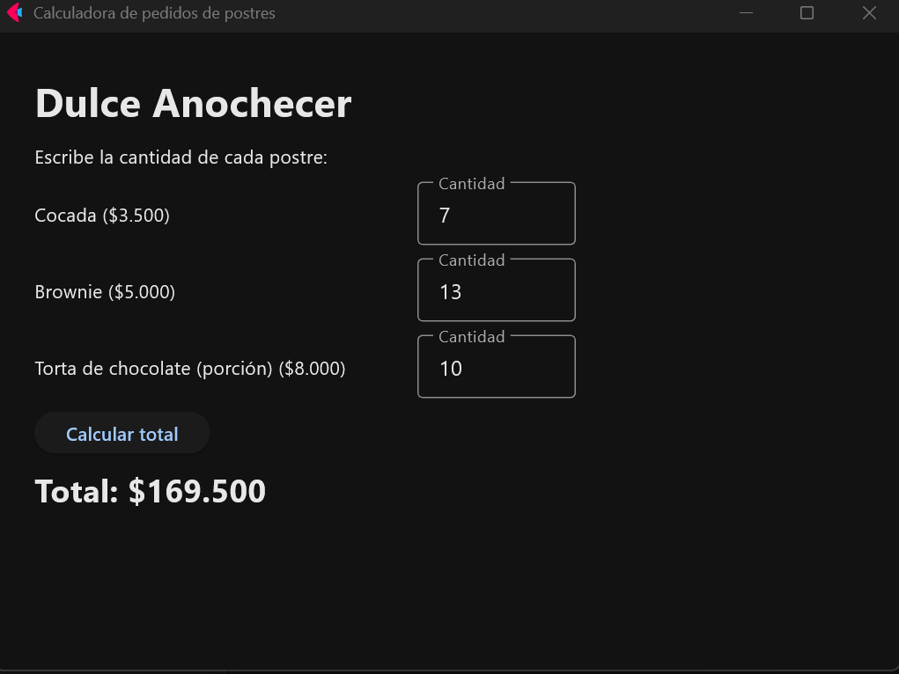

# Calculadora de pedido de postres con Flet

Aplicación gráfica mínima en Python hecha con la biblioteca **Flet** para la actividad de *Interfaces gráficas y programación orientada a eventos*. La app simula el pedido de una pastelería (Dulce Anochecer): el usuario escribe cuántas unidades quiere de cada postre, presiona un botón y la pantalla muestra el total a pagar.

## Biblioteca seleccionada: Flet

Flet es un framework de interfaces gráficas para Python. Permite crear aplicaciones de escritorio, web y móviles escribiendo solo Python, sin necesidad de HTML, CSS, JavaScript ni conocimientos previos de Flutter (la tecnología que Flet usa por debajo para dibujar la interfaz).

### Investigación

**1. ¿Qué es y cuál es su propósito principal?**
Es una biblioteca para construir interfaces gráficas modernas con Python. Su propósito es que un desarrollador Python pueda crear aplicaciones visuales sin salir de ese lenguaje.

**2. ¿Qué tipo de aplicaciones permite desarrollar?**
Aplicaciones interactivas para escritorio, web y móvil, por ejemplo formularios, contadores, listas de tareas, calculadoras y paneles de datos.

**3. ¿Cómo se instala y qué requisitos necesita?**
- Requiere Python 3.10 o superior.
- Funciona en macOS 12 o posterior, Windows 10/11 de 64 bits y Linux.
- Se instala con `pip install flet` (la documentación recomienda usar un entorno virtual). Para comprobar la instalación se usa `flet doctor`.

**4. ¿Cuáles son sus principales componentes o elementos gráficos?**
En Flet todo es un *control* que se agrega a una página (`Page`), que representa la ventana. Algunos controles son `Text`, `TextField`, `Button`, `IconButton`, `Row`, `Column`, `Container`, `NavigationBar` y `AlertDialog`. El listado completo está en la sección *Controls* de la documentación oficial.

**5. ¿Cómo maneja los eventos del usuario?**
Cada control tiene propiedades de evento, como `on_click` (clic) y `on_change` (cambio en un campo de texto). Se les asigna una función y Flet la ejecuta cuando el usuario realiza la acción; esa función recibe un objeto de evento (`e`) con información del control que lo originó. Para el teclado existe un evento global, `page.on_keyboard_event`, que entrega la tecla presionada y si Shift, Ctrl, Alt o Meta estaban activadas.

**6. Ventajas y limitaciones frente a Tkinter**

| | Flet | Tkinter |
|---|---|---|
| Apariencia | Moderna (Material Design) por defecto | Más básica, requiere trabajo para modernizarla |
| Plataformas | Escritorio, web y móvil | Solo escritorio |
| Organización de la interfaz | Controles anidados (`Row`, `Column`) | Gestores `pack`, `grid` y `place` |
| Instalación | Requiere instalar el paquete | Viene incluido con Python |
| Madurez | Más reciente y con cambios frecuentes entre versiones | Muy estable y con mucha documentación |
| Peso | Más pesado (usa Flutter por detrás) | Muy liviano |

## Instalación y ejecución

1. Clonar el repositorio:

   ```bash
   git clone https://github.com/TU_USUARIO/calculadora-postres-flet.git
   cd calculadora-postres-flet
   ```

2. (Recomendado) Crear y activar un entorno virtual. En Windows:

   ```bash
   python -m venv .venv
   .venv\Scripts\activate
   ```

   En macOS o Linux: `source .venv/bin/activate`.

3. Instalar las dependencias:

   ```bash
   pip install -r requirements.txt
   ```

4. Ejecutar la aplicación:

   ```bash
   python calculadora_postres.py
   ```

   Para ejecutar la versión del reto adicional (con controles personalizados):

   ```bash
   python calculadora_postres_poo.py
   ```

Probado con Python 3.13.5 y Flet 1.1.2 en Windows 11.

## Explicación del ejemplo

El código está en `calculadora_postres.py` y usa dos clases:

- **`Postre`**: guarda el nombre y el precio de un postre.
- **`CalculadoraPedido`**: construye la pantalla (`construir_pantalla`) y responde al botón (`calcular_total`).

### Cómo se crea la ventana
`ft.run(main)` abre una ventana de escritorio y llama a la función `main`, a la que entrega el objeto `page` (la ventana). En `construir_pantalla` se configuran el título, el margen y el tamaño (`page.window.width` y `page.window.height`).

### Cómo se crean y muestran los componentes
En `construir_pantalla` se crean los controles y se agregan con `page.add(...)`: textos (`ft.Text`), un campo de cantidad por postre (`ft.TextField`), filas que alinean cada postre con su campo (`ft.Row`) y el botón (`ft.Button`). Los campos se generan con un ciclo `for` sobre la lista de postres, por lo que agregar un postre a la lista crea su fila automáticamente.

### Evento implementado y cómo se detecta
El evento es el **clic en el botón "Calcular total"**. Se detecta con la propiedad `on_click` del botón: `on_click=self.calcular_total`. Cada vez que el usuario hace clic, Flet ejecuta ese método.

### Método que responde al evento
`calcular_total` lee la cantidad de cada campo, la convierte a entero, multiplica por el precio del postre y suma el total. Si el usuario escribe algo que no es un entero mayor o igual a cero, `try/except` captura el error y se prepara un mensaje de aviso.

### Cómo cambia la interfaz
Dentro de `calcular_total` se modifica el `value` de los textos: `self.resultado.value` muestra el total (por ejemplo "Total: $169.500") o `self.mensaje.value` muestra un aviso en rojo si hay un dato inválido. Luego `self.page.update()` le pide a Flet que redibuje la ventana con los valores nuevos.

## Reto adicional: interfaces con clases y objetos

La versión del reto está en el archivo `calculadora_postres_poo.py`. Tiene el mismo funcionamiento que la versión base, pero la interfaz se construye con clases propias que heredan de controles de Flet.

**¿Flet permite construir interfaces con clases y objetos?** Sí. La documentación oficial indica que los controles incluidos en Flet se pueden usar para crear componentes reutilizables propios mediante programación orientada a objetos en Python. Hay dos tipos:

- **Controles con estilo:** una clase que hereda de un control existente (por ejemplo `ft.Button`) y cambia sus propiedades por defecto.
- **Controles compuestos:** una clase que hereda de un contenedor como `ft.Column` o `ft.Row` y combina varios controles dentro. La documentación usa como ejemplo un control `Task` para una app de tareas.

Las clases se decoran con `@ft.control` (o `@dataclass`), y sus controles internos se pueden crear en el método `init()`. Además, Flet ofrece métodos de ciclo de vida como `build()`, que se llama cuando el control se crea y queda asociado a la página.

### Responsabilidades de cada clase

| Clase | Tipo | Responsabilidad | Lo que NO hace |
|---|---|---|---|
| `Postre` | Clase Python normal (modelo de datos) | Guardar el nombre y el precio de un postre y calcular el subtotal para una cantidad dada. | No conoce la interfaz gráfica. |
| `FilaPostre` | Control compuesto (hereda de `ft.Row`) | Mostrar un postre en pantalla (nombre, precio y campo de cantidad) y leer la cantidad que escribe el usuario, devolviendo el subtotal. | No suma el total ni responde al botón. |
| `CalculadoraPedido` | Control compuesto (hereda de `ft.Column`) | Armar la pantalla completa, recibir el evento del botón (`calcular_total`), sumar los subtotales y actualizar el total o el mensaje de error. | No calcula precios ni lee campos directamente; se lo pide a las filas. |

En esta versión, la función `main` solo configura la ventana y agrega la pantalla. La función `formatear_pesos` es una utilidad que da formato de pesos a los números.

Esta separación hace el código más fácil de mantener: si cambia la forma de calcular el precio de un postre, se modifica `Postre`; si cambia el aspecto de una fila, se modifica `FilaPostre`; si cambia el comportamiento del botón, se modifica `CalculadoraPedido`.

## Evidencia

Aplicación funcionando: 7 cocadas, 13 brownies y 10 porciones de torta dan un total de $169.500.



## Fuentes consultadas

- Documentación oficial de Flet, instalación: https://docs.flet.dev/getting-started/installation
- Documentación oficial de Flet, atajos de teclado (eventos del teclado): https://docs.flet.dev/cookbook/keyboard-shortcuts
- Documentación oficial de Flet, `KeyboardEvent`: https://docs.flet.dev/types/keyboardevent
- Documentación oficial de Flet, `Page`: https://flet.dev/docs/controls/page
- Documentación oficial de Flet, controles personalizados (reto adicional): https://docs.flet.dev/cookbook/custom-controls
- Sitio oficial de Flet: https://flet.dev
- Reporte en GitHub sobre el manejo del teclado en Flet: https://github.com/flet-dev/flet/issues/6261